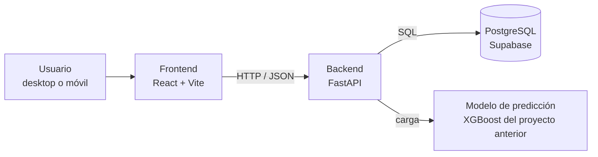
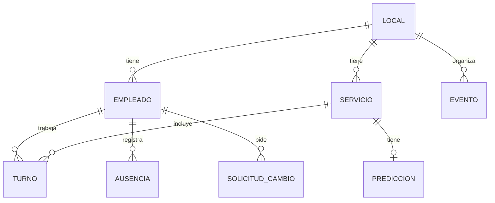

# SkillUp · App de turnos para restaurantes

SkillUp ayuda a un restaurante (nuestro primer cliente es una cervecería) a **tener la dotación correcta en cada servicio**. La app anticipa en qué servicios va a faltar gente, sobre todo en los días de sobredemanda (viernes, sábados, días de pago, quincenas, feriados y eventos), y propone a quién mover o llamar para cubrir.

Este repositorio contiene el **prototipo funcional** de la app: frontend, backend y base de datos. El modelo de predicción y los datos simulados vienen del proyecto anterior, [`skillup-dotacion-laboral`](https://github.com/yongiluu/skillup-).

---

## El problema

- La demanda no es pareja: el almuerzo (13–15) y la cena (19–21) de un viernes post-quincena no se parecen a un martes en la mañana.
- Hay roles críticos (garzón, cocinero de línea, jefe de turno). Si falta uno de ellos, el servicio se resiente.
- Las ausencias con aviso corto se resuelven hoy por WhatsApp y a última hora.

## Qué hace la app (alcance del prototipo)

**Desktop: jefe de turno / administración**
1. **Hoy**: cobertura del día, servicios en riesgo, ausencias y acciones sugeridas ("mover al runner X a garzón de 13–15").
2. **Planificador semanal**: grilla de servicio × día con la dotación actual/requerida y la probabilidad de déficit, más un calendario que marca días de pago, quincenas, feriados y eventos.
3. **Equipo y fichas**: ficha de cada empleado con rol, roles que puede cubrir, días seguidos trabajados, horas extra, ausencias y próximos turnos.

**Móvil: el día a día**
1. **Empleado**: mis turnos, pedir cambio de turno, tomar turnos extra y avisos.
2. **Jefe de turno**: el servicio más crítico del día, el resto del día y la semana.

**Fuera del alcance por ahora** (pendiente de la reunión con la cervecería):
- Integración con relojes inteligentes y test psicológicos. Se mostrarán como "pendiente".
- Datos reales de la cervecería (eventos, días hábiles, dotación real). Mientras tanto usamos los datos simulados.

> El diseño de referencia (pantallas desktop y móvil) está en el canvas de diseño de SkillUp y en `desktop-prototype/` y `mobile-prototype/` del repo anterior.

---

## Arquitectura



### Stack propuesto

| Capa | Tecnología | Por qué |
|---|---|---|
| Frontend | React + Vite + TypeScript | Rápido de levantar y sirve tanto para desktop como para móvil (diseño responsive) |
| Backend | Python + FastAPI | El modelo y el ETL ya están en Python, y FastAPI genera la documentación de la API sola (`/docs`) |
| Base de datos | PostgreSQL en Supabase | Gratis para prototipo, compartida entre los 3, con panel web y backups |

Si el equipo prefiere otra cosa, se discute en un issue antes de empezar.

---

## Equipo y responsabilidades

Cada persona es **dueña** de una capa: la decide, la construye y revisa los PRs que la tocan. Igual todos podemos opinar y ayudar en todo.

| Rol | Responsable | Carpeta |
|---|---|---|
| Frontend (UI/UX) | [Nombre] | `frontend/` |
| Backend (API e integraciones) | [Nombre] | `backend/` |
| Base de datos | [Nombre] | `database/` |

### Frontend (UI/UX)
- Llevar el diseño de referencia a componentes: vistas Hoy, Planificador y Equipo (desktop), y Empleado y Jefe de turno (móvil).
- Mantener un sistema visual simple: colores, tipografías, estados de riesgo (bajo / alerta ≥ 0,55 / alto ≥ 0,75).
- Consumir la API. Mientras el backend no esté listo, usar datos de ejemplo (mocks) con la **misma forma** que el contrato de la API.
- Accesibilidad básica: botones reales, contraste suficiente y objetivos táctiles de 44 px o más.

### Backend (API e integraciones)
- Exponer la API REST del [contrato](#contrato-de-la-api-borrador) y documentarla en `/docs`.
- Conectar con la base de datos y servir las predicciones del modelo.
- Lógica de negocio: quién puede cubrir a quién (respaldos por rol), solicitudes de cambio de turno y aprobación.
- Autenticación simple con dos perfiles: `jefe_turno` y `empleado`.

### Base de datos
- Diseñar el esquema (ver [modelo de datos](#modelo-de-datos-borrador)) y crear las migraciones en `database/`.
- Cargar los datos simulados del proyecto anterior (`data/restaurant/`) como semilla (*seed*).
- Configurar Supabase: proyecto compartido, accesos para los 3 y respaldos.
- Cuidar los datos sensibles: los datos de salud o biometría van en tablas separadas, con acceso restringido y consentimiento registrado.

---

## Contrato de la API (borrador)

Lo acordamos **antes** de programar, así frontend y backend avanzan en paralelo. Cualquier cambio se hace por PR y se avisa a los otros dos.

| Método | Ruta | Para qué |
|---|---|---|
| `POST` | `/auth/login` | Iniciar sesión (devuelve token y perfil) |
| `GET` | `/servicios?fecha=YYYY-MM-DD` | Servicios del día con dotación, demanda y probabilidad de déficit |
| `GET` | `/semana?inicio=YYYY-MM-DD` | Grilla de 7 días × 4 servicios |
| `GET` | `/calendario?mes=YYYY-MM` | Días de pago, quincenas, feriados y eventos |
| `GET` | `/sugerencias?fecha=YYYY-MM-DD` | Acciones sugeridas de cobertura |
| `GET` | `/empleados` · `/empleados/{id}` | Lista y ficha |
| `GET` | `/empleados/{id}/turnos` | Turnos de una persona |
| `POST` | `/solicitudes-cambio` | Pedir un cambio de turno |
| `PATCH` | `/solicitudes-cambio/{id}` | Aprobar o rechazar (jefe de turno) |
| `POST` | `/eventos` | Registrar un evento de la cervecería |

Ejemplo de respuesta de `GET /servicios`:

```json
{
  "fecha": "2025-10-17",
  "servicio": "13_15",
  "requeridos": 23,
  "asignados": 21,
  "cubiertos_previstos": 91,
  "prob_deficit": 0.97,
  "prob_por_rol": { "garzon": 0.23, "cocinero_linea": 0.32, "jefe_turno": 0.01 },
  "recomendacion": "Activar reemplazo inmediato y reforzar cocinero de línea"
}
```

## Modelo de datos (borrador)



- **local**: sucursal de la cervecería.
- **empleado**: rol, rol de respaldo, polivalente (sí/no), antigüedad, tipo de contrato y preferencia de turno.
- **servicio**: fecha más franja (`11_13`, `13_15`, `19_21`, `21_23`) y dotación requerida.
- **turno**: qué empleado trabaja en qué servicio y con qué rol.
- **ausencia**: fecha, motivo y si fue con aviso corto.
- **prediccion**: probabilidad de déficit total y por rol crítico, y recomendación.
- **calendario / evento**: feriados, días de pago y eventos del local.
- **solicitud_cambio**: quién pide, quién cubre y estado (pendiente / aprobada / rechazada).

---

## Estructura del repositorio

```
App-skillup/
├── frontend/      # React + Vite (UI desktop y móvil)
├── backend/       # FastAPI (API, lógica, modelo)
├── database/      # migraciones, seed y diagramas
├── docs/          # decisiones, contrato de API, notas de reuniones
└── README.md
```

---

## Cómo trabajamos

**Ramas**
- `main` siempre funciona. Nadie hace push directo a `main`.
- Cada tarea va en su rama: `frontend/vista-hoy`, `backend/endpoint-servicios`, `database/esquema-inicial`.

**Pull requests**
- Todo entra por PR, con al menos **una revisión** de otra persona del equipo.
- El PR explica qué cambia y cómo probarlo, e incluye capturas si toca la UI.
- Si el PR cambia el contrato de la API o el esquema de la base de datos, se avisa a los otros dos antes del merge.

**Tareas**
- Usamos los *Issues* de GitHub con etiquetas `frontend`, `backend`, `database` y `docs`.
- Cada issue tiene un responsable y un "listo cuando…" claro.

**Secretos**
- Las claves de Supabase y otros servicios van en `.env`, que **nunca** se sube al repo. Se versiona un `.env.example` sin valores reales.

---

## Hoja de ruta

| Etapa | Frontend | Backend | Base de datos |
|---|---|---|---|
| 1. Bases | Proyecto Vite, sistema visual y navegación | Proyecto FastAPI y endpoints con datos de ejemplo | Esquema inicial en Supabase |
| 2. Conectar | Vistas Hoy y Planificador con mocks | Endpoints conectados a la base de datos | Seed con los datos simulados |
| 3. Funcionalidad | Equipo, fichas y vistas móviles | Sugerencias, solicitudes de cambio y login | Índices, permisos y respaldos |
| 4. Demo | Pulido y pruebas en celular | Modelo de predicción integrado | Datos reales de la cervecería (si ya los tenemos) |

## Pendientes con la cervecería

- [ ] Eventos del mes (partidos, lanzamientos, tocatas)
- [ ] Días hábiles y horario real de atención
- [ ] Dotación real por rol
- [ ] Días de pago relevantes para sus clientes
- [ ] Decisión sobre relojes inteligentes y test psicológicos (y su consentimiento)

---

## Licencia

Ver [LICENSE](LICENSE).
